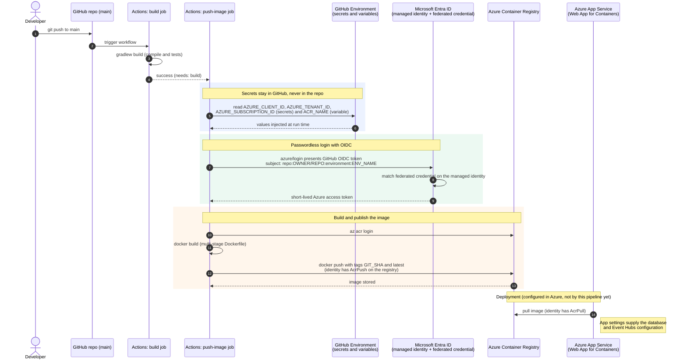

- Create the github actions file in the .github/workflow as a yaml file
- in order to create the azure integration we need following information declared as a environment. It is possible to set these values without an environment but it is more onvenient when we need to deploy to multiple environments. 
 
 Secrets 

 - Client Id
 - tennanet Id
 - Subscription id

 variables
 - ACR name
 - repositoru name

 From azure side

 - Create a application in the application registry
 - Assign a AcrPush Role in the application on the container registry
 

 When running console commands use the following prefix so that it would rewrite the windows path as a prefix
 ```bash
 export MSYS_NO_PATHCONV=1
 ```
 ## References 
 - https://github.com/Azure/login#login-with-a-service-principal-secret

 ## Commands
```bash
- az acr show -n learnstuff --query id -o tsv
- az role assignment create --assignee e82d58cd-970c-407d-90f6-6501f1c88f38 --role AcrPush --scope "/subscriptions/1f681932-af34-40e4-be5a-858701c64d48/resourceGroups/loginappresources/providers/Microsoft.ContainerRegistry/registries/learnstuff"

- $acrId = az acr show -n learnstuff --query id -o tsv
- az role assignment create --subscription 1f681932-af34-40e4-be5a-858701c64d48 --assignee e82d58cd-970c-407d-90f6-6501f1c88f38 --role AcrPush --scope "/subscriptions/1f681932-af34-40e4-be5a-858701c64d48/resourceGroups/loginappresources/providers/Microsoft.ContainerRegistry/registries/learnstuff" 
- $ MSYS_NO_PATHCONV=1 az role assignment create --assignee e82d58cd-970c-407d-90f6-6501f1c88f38 --role AcrPush --scope "/subscriptions/1f681932-af34-40e4-be5a-858701c64d48/resourceGroups/loginappresources/providers/Microsoft.ContainerRegistry/registries/learnstuff"
- https://api.github.com/users/dtbwije
- https://api.github.com/repos/dtbwije/kubernetes

- az role assignment list --assignee <client-id-of-appuserassiggned1> --scope (az acr show -n learnstuff --query id -o tsv) -o table

```


