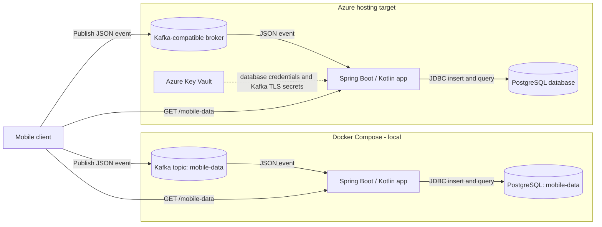

# Mobile Data Service
This setup is an experimental setup for mobile application application that manages flickr images.

- DASHBOARD - https://dev.azure.com/dtbwije/HouseProjects
- Agentic Software modeling - https://asdlc.io/


## Architecture



## Agents


## Tools
- 

## Run Locally

Prerequisites: 
- Docker Desktop 
- Java 17-compatible JDK.

Tested on bashShell on windows.

On macOS/Linux (bash or zsh):

```bash
cp .env.example .env
./gradlew bootJar
docker compose up --build
```

Compose starts PostgreSQL and Kafka first and waits for both health checks before starting the app. The app listens at `http://localhost:8080`; if that host port is busy, start with another port:

On macOS/Linux (bash or zsh):

```bash
APP_PORT=8081 docker compose up --build
```
### Accessing the applicaiton
- REST API get mobile data endpoing is  `GET http://localhost:8080/mobile-data` (use `8081` if you changed `APP_PORT`).
On macOS/Linux (bash or zsh):

```bash
printf '%s\n' '{"deviceId":"device-1","value":42}' | docker compose exec -T kafka /opt/kafka/bin/kafka-console-producer.sh --bootstrap-server kafka:29092 --topic mobile-data
curl http://localhost:8080/mobile-data
```
## Database setup
- connect to `localhost:5432`, 
- database `mobile-data`, 
- username `hellokube`,
- `POSTGRES_PASSWORD` value from `.env`. 
- The sample password in `.env.example` is for local development only. PostgreSQL data is persisted in a Docker volume.

## Azure

THIS PART IS NOT IMPLEMENTED YET

The `cloud` Spring profile accepts database settings through environment variables and configures Kafka TLS using mounted keystore/truststore files and secret-sourced passwords. Supply these from Azure Key Vault and the chosen Azure hosting platform; do not commit production secrets.

Azure hosting is a target, not yet a complete deployment in this repository. The Terraform currently creates an Azure resource group; it does not provision the application platform, Kafka, or PostgreSQL. The Kubernetes manifests and additional run notes are maintained separately.

## Kubernetes Training

Kubernetes training material can be found [here](kubeneters.md).

